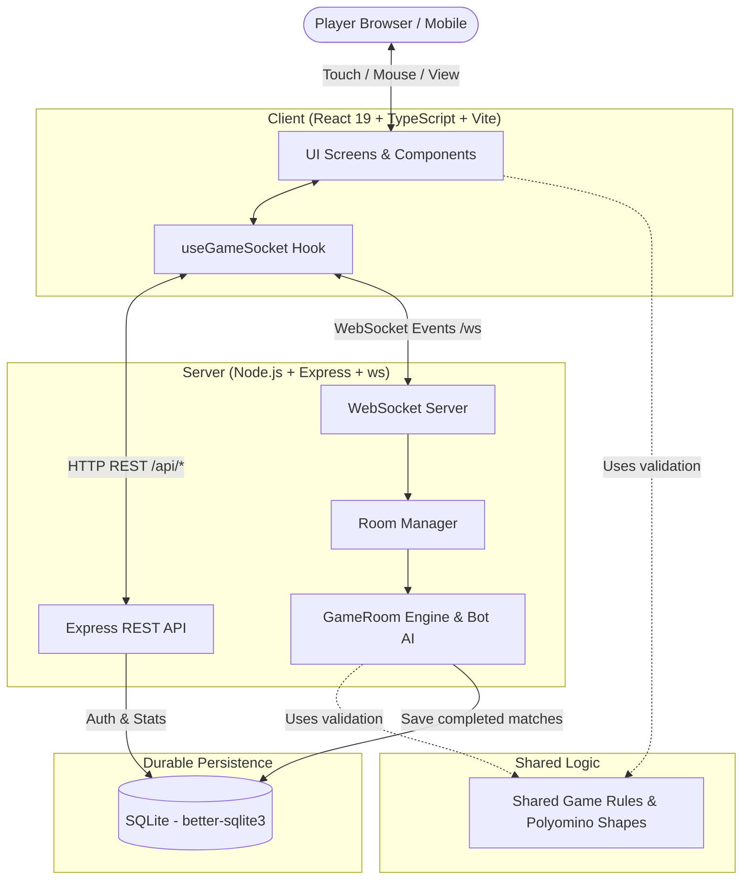

# 🏛️ PerfOps Blokus — Global Architecture, Frameworks & Tools

A concise, high-level guide explaining the global architecture, core technology stack, and tools powering the **Blokus Online** application.

---

## 1. High-Level Architecture Overview

The system follows a modern **Decoupled Client-Server Architecture** optimized for real-time multiplayer interactions:

- **Frontend (Client):** A responsive React Single Page Application (SPA) running in the user's browser.
- **Backend (Server):** A Node.js service providing both REST HTTP endpoints (for durable user data) and a bidirectional WebSocket server (for sub-10ms game sync).
- **In-Memory Engine:** Active rooms and game board validations run entirely in server RAM for instant responsiveness.
- **Durable Storage:** An embedded SQLite database preserves user accounts, match histories, and leaderboard statistics.

---

## 2. Core Architectural Layers

### 2.1 Frontend Client (`/client`)
- **Role:** Handles rendering, user inputs, responsive layouts, audio feedback, and local optimistic validations.
- **Key Modules:**
  - **Screen State Machine:** Renders `SplashScreen`, `LobbyScreen`, `MatchScreen`, `ProfileScreen`, `LeaderboardScreen`, or `RulesScreen`.
  - **Board & Loupe View:** High-precision touch magnifier and SVG polyomino rendering.
  - **Real-Time Client Hook (`useGameSocket`):** Manages WebSocket connection lifecycle, auto-reconnects, and converts incoming messages into reactive React state.

### 2.2 Backend Server (`/server`)
- **Role:** Central source of truth for lobby orchestration, turn enforcement, AI bot moves, and user management.
- **Key Modules:**
  - **HTTP API Router:** Serves `/api/register`, `/api/login`, `/api/profile/:id`, and `/api/leaderboard`.
  - **WebSocket Dispatcher:** Routes incoming JSON actions (`CREATE_ROOM`, `JOIN_ROOM`, `SET_READY`, `ADD_BOT`, `START_GAME`, `MAKE_MOVE`, `PASS_TURN`).
  - **In-Memory Room Manager (`roomManager.ts`):** Tracks live rooms by short join codes with zero database read overhead per move.
  - **Authoritative Game Loop (`gameRoom.ts`):** Validates moves, runs countdown timers, and executes bot decisions.

### 2.3 Shared Engine (`/shared`)
- **Role:** Shared TypeScript logic imported by both client and server to guarantee identical rule validation:
  - **21 Polyomino Shapes:** Definitions of all standard Blokus pieces (monomino to pentominoes).
  - **Game Rules:** Corner-to-corner adjacency, edge-to-edge collision detection, and start-corner constraints for 2P, 3P, and 4P modes.

---

## 3. Technology Stack: Frameworks & Libraries

### 3.1 Frontend Stack

| Tool / Library | Version | Purpose |
|---|---|---|
| **React** | `19.0` | Declarative UI component tree and state management |
| **TypeScript** | `5.7` | Static typing across components, models, and WebSocket events |
| **Vite** | `6.1` | Lightning-fast build tool, local dev server, and reverse proxy |
| **Lucide React** | `0.474` | Clean, modern iconography |
| **Canvas Confetti** | `1.9` | Celebration particle effects on match victories |
| **Vanilla CSS** | — | High-performance CSS design system with custom variables and zero runtime overhead |

### 3.2 Backend Stack

| Tool / Library | Version | Purpose |
|---|---|---|
| **Node.js** | `>=18` | JavaScript runtime environment |
| **Express** | `4.21` | HTTP web server for REST endpoints and middleware |
| **ws** | `8.18` | High-throughput, lightweight RFC-compliant WebSocket server |
| **better-sqlite3** | `13.0` | Ultra-fast synchronous SQLite driver for reliable persistence |
| **prom-client** | `15.1` | Prometheus metrics collection (`/metrics`) for system observability |
| **tsx** | `4.19` | Native TypeScript daemon with instant live-reload for backend development |

---

## 4. Communication & Protocols

The app splits communication into two distinct patterns:

### 4.1 REST API (HTTP / JSON)
Used for discrete, transactional, non-realtime operations:
- `POST /api/register` — Create player account with hashed credentials.
- `POST /api/login` — Authenticate and receive a session token.
- `GET /api/profile/:userId` — Fetch player career statistics, win rates, and recent match history.
- `GET /api/leaderboard` — Fetch top-ranking players by victories.

### 4.2 WebSockets (Persistent TCP / JSON)
Used for live game sessions with bidirectional real-time messaging:
- **Client to Server:** `CREATE_ROOM`, `JOIN_ROOM`, `SET_READY`, `ADD_BOT`, `START_GAME`, `MAKE_MOVE`, `PASS_TURN`.
- **Server to Client:** `ROOM_STATE`, `GAME_STARTED`, `MOVE_PLAYED`, `GAME_OVER`, `ERROR`.

---

## 5. Development & Deployment Tools

- **Local Development Orchestration:** Root `package.json` scripts execute client and server concurrently:
  - Client dev server runs on `http://localhost:3000` (configured with Vite proxy for `/api` and `/ws`).
  - Server runs on `http://localhost:3001`.
- **Build Pipeline:**
  - TypeScript compiler (`tsc`) guarantees type correctness across both layers.
  - Vite bundles optimized static HTML/CSS/JS artifacts into `client/dist`.
- **Observability:** Prometheus-ready `/metrics` endpoint on the server exposes socket counts, room counts, and request timings for monitoring setups.
